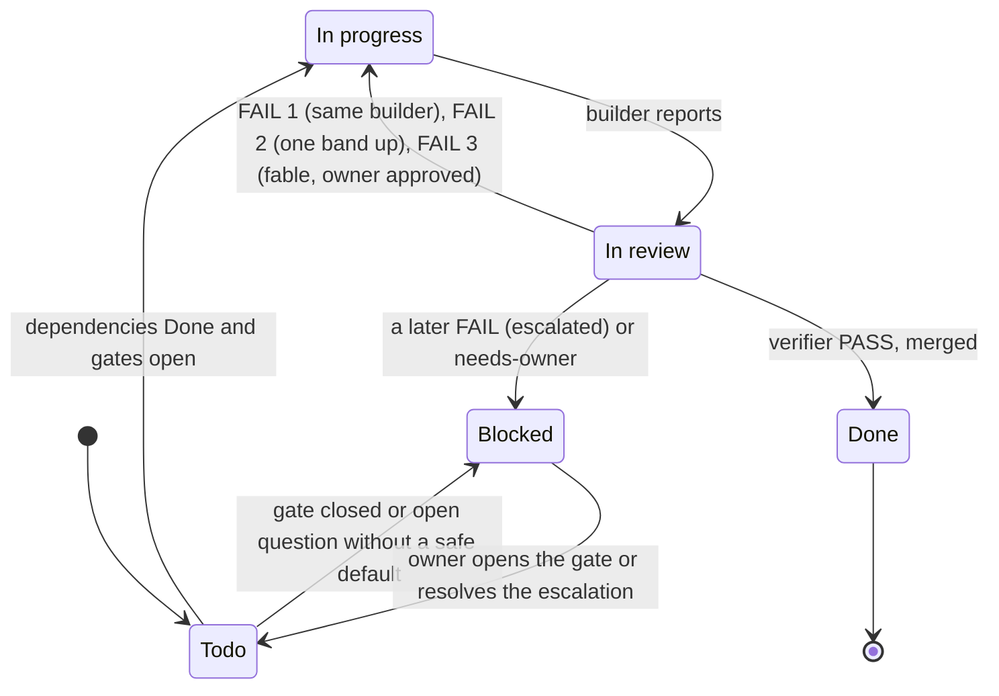

# Orchestration protocol - how {{PROJECT}} is built

This document is the operating manual for the **orchestrator** (a Claude session that coordinates the build),
the **builders** (subagents that implement one task card each) and the **verifiers** (subagents that check every
finished card before it is merged). The cards are in [tasks.md](tasks.md). The agent definitions the orchestrator
spawns are in `.claude/agents/`; the builder report and the verifier verdict formats live only there.

Nothing here changes the design. The RFC, the spec, the ADRs, the architecture and the roadmap remain the
sources of truth; the cards only slice them into deliverable units. Card counts (per phase, band and size) live only
in the header of [tasks.md](tasks.md); this document does not repeat them.

<!-- FILL: Adjust every value in section 1 to the project's stack and remove this comment. The values shown are the
house .NET defaults (references/presets/dotnet-house.md in the project-blueprint skill); replace them for another
stack and keep the row when the setting still applies. Keep one of the two Merge rows of section 3.1. -->

## 1. Build settings

Every rule below refers to these settings by name, so a stack change is made here once.

| Setting | Value |
|---|---|
| Install | `dotnet restore` <!-- FILL: e.g. `npm ci --ignore-scripts` for agents (worktrees share one .git/hooks, so agents never run install scripts) --> |
| Build command | `dotnet build` (zero errors, zero new warnings) <!-- FILL: e.g. `npm run build`, `./gradlew assembleDebug`, Unity batch-mode build --> |
| Test command | `dotnet test` <!-- FILL: e.g. `npm test`, `./gradlew test`, Unity `-runTests` --> |
| Verify command | one command that chains every gate (build, type check, lint with zero warnings, format, architecture rules, tests with coverage); CI runs the same <!-- FILL: e.g. `npm run verify`, `./verify.ps1` --> |
| Test-first | on: failing test, then code, then refactor; the `test:` commit comes before the commit that makes it pass <!-- FILL: keep "on" unless the owner decided otherwise (record the DEC-nn) --> |
| Test levels | Unit (no I/O), Integration (exactly one real boundary), E2E (a user journey through the running app) |
| Level marker | `[Trait("Level", "Unit" \| "Integration" \| "E2E")]` on every test <!-- FILL: e.g. the test folder (`tests/unit`, `tests/integration`, `tests/e2e`), NUnit `[Category]`, pytest markers --> |
| Test pyramid | 60 / 30 / 10 (unit / integration / E2E) by test count per release, 10 points tolerance; a guideline that warns (opt-in switch to enforce); a test without a level marker or a run counting zero tests fails <!-- FILL: from bank 7.2; change only with an ADR --> |
| Coverage | per module tier: core 100 %, important 80 %, infrastructure no target <!-- FILL: from bank 7.8; name the core modules --> |
| Pyramid report | the script delivered by the E2E harness card; it also fails on a stale report or a test outside the level folders <!-- FILL: name the card id and the script path --> |
| Red check and mutation check | on: the verifier confirms the new tests fail on the `test:` commit and that removing a guard turns a test red |
| E2E tool | Playwright <!-- FILL: e.g. Playwright for .NET, Playwright (Node), Espresso, Unity PlayMode tests --> |
| Page walk | on for cards that deliver or change pages; preview entry `{{PROJECT_SLUG}}-web` in `.claude/launch.json`; viewports 1366x768 and 390x844, light and dark <!-- FILL: sizes and color schemes from docs/design-system.md; a screenshot script is a cheaper, repeatable alternative to the browser tools; "off" when the project has no UI --> |
| Design principles | SOLID and KISS (no abstraction, package or generic mechanism the card does not ask for) |
| Card size | agent working time: S up to about 1 hour, M about 2-3 hours, L about 4-6 hours |
| Branch name | `task/<id>-<kebab-title>` in lower case, e.g. `task/p1-03-authentication`; `docs/<topic>` and `fix/<issue>-<slug>` outside cards |
| Commit message | Conventional Commits (`test:`, `feat:`, `fix:`, `refactor:`, `docs:`, `chore:`), lower case, header at most 72 characters, one or more `Refs:` lines, and the attribution line given by the session instructions (it names the tool and model that did the work) |
| Issue and pull request | one issue per card (milestone = phase, labels `difficulty:n` and `builder:<band>`), one pull request per card from the template, closing its issue <!-- FILL: delete this row for a local-only repository --> |
| Merge | see section 3.1 <!-- FILL: keep the variant this project uses --> |
| Agents in flight | 1, under the usage throttle of section 8.1 <!-- FILL: from bank 8.7; record each later change as a DEC --> |
| Serialized resources | database migrations folder; the composition root; the package and solution manifests; CI workflow files; shared registries every feature appends to (route tables, access-matrix rows, error-code catalogue) <!-- FILL: e.g. `Database/Migrations`, `Program.cs`, `Directory.Packages.props`, `package.json`, `.github/workflows/` --> |
| Requirement comment | `// RF-nnn` at each implementing type; test names start with the requirement id <!-- FILL: comment syntax of the stack --> |

## 2. Roles and bands

Every card carries a Difficulty from 1 to 10; the band picks the builder and the verifier.

| Role | Agent | Model | Responsibility | May edit |
|---|---|---|---|---|
| Orchestrator | `orchestrator` run as the main session (`claude --agent orchestrator`) or the session itself following this file; never spawned as a subagent, because subagents cannot spawn builders | strongest available | reads this file, `tasks.md` and `handoff.md`; picks ready cards; spawns one builder per card and the verifier of its band; merges under section 3.1; stops at gates and escalations | Status lines and new follow-up cards (through the status pull request of section 3.1), `handoff.md`, the project notes CLAUDE.md names, merges |
| Builder, difficulty 1-5 | `builder-haiku` | `haiku` | fully specified work with a pattern to copy and written probes: text, wording, small fixes with a reproducing test, CRUD on an existing pattern | files inside the card's scope |
| Builder, difficulty 6-8 | `builder-sonnet` | `sonnet` | substantial work inside a documented design: vertical slices, adapters, background jobs, multi-step UI flows, E2E journeys | files inside the card's scope |
| Builder, difficulty 9-10 | `builder-opus` | `opus` | work where a mistake leaks a secret, grants access wrongly, loses data or needs a manual production fix | files inside the card's scope |
| Builder, escalation | `builder-fable` | `fable` | only the third attempt at a card, after {{OWNER}} approves it in chat; no card starts here | files inside the card's scope |
| Verifier, difficulty 1-8 | `verifier` | `sonnet` | independent check of a finished card; runs the gates itself; returns PASS or FAIL with findings; never edits the branch | nothing in the branch (disposable detached worktrees for the red and mutation checks, removed afterwards) |
| Verifier, difficulty 9-10 | `verifier-opus` | `opus` | the same, for difficulty 9-10, for cards promoted to opus, and for every card on a security or privacy boundary (the strongest available model there) | as above |
| Product owner | {{OWNER}} | - | answers open questions, opens human gates, approves escalations, merges `needs-owner` pull requests, does what needs access Claude does not have | anything |

**Rating rule of thumb.** If a mistake would leak a credential, grant a permission wrongly, corrupt or lose data,
double an external side effect, or need a manual data fix in production, the card is 9-10. If the card has a working
pattern to copy, written probes and nothing to decide, it is 1-5. Everything else is 6-8. A card on a security or
privacy boundary is at least 6. <!-- FILL: add one project-specific sentence naming the kinds of work that are 9-10 here. -->

The band names follow the Claude model aliases the Agent tool accepts. When models change, keep the criteria and
change only the `model:` lines in `.claude/agents/` and this table. The verifier moves up with the builder when a
card is promoted.

## 3. Card life cycle



Status values (the only text the orchestrator writes on a card): `Todo`, `In progress`, `In review`, `Done`,
`Blocked (<reason>)`. The reason is a gate (`Blocked (G-01)`), an open question (`Blocked (Q-nn)`), an escalation
(`Blocked (escalated YYYY-MM-DD - see handoff.md)`), an owner merge (`Blocked (needs-owner - see #<pr>)`) or a
withdrawal (`Blocked (withdrawn YYYY-MM-DD - see <card id>)`). When only part of a card waits, the rest runs:
`Todo; <part> Blocked (Q-nn)`. A card whose code merged but whose owner check is still open stays `In review`.

1. **Select.** A card is ready when its Status is `Todo`, every id in *Depends on* is `Done` and every gate it names
   is `Open` in the Gates table of `handoff.md`. Ready cards run in parallel within section 8. A `Provisional` gate
   releases only the cards its note in `handoff.md` names. When a gate opens, the cards it held go back to `Todo`.
2. **Brief the builder** with the card verbatim (its Review probes and Behaviour to preserve included), its *Reads*
   list, section 1, the builder file of its band and the numbers it may take from any shared series (error codes,
   migrations, prompt versions). One card per builder, one builder per card, each in its own worktree and branch.
3. **The builder reports.** The orchestrator does not judge the report; it spawns the verifier of the card's band
   with the card, the report and the branch (or pull request).
4. **The verifier returns** PASS or FAIL.
   - PASS: merge under section 3.1, record `Done`, file every MINOR finding as a follow-up card (section 9), copy
     "owner check pending" items to the owner's agenda in `handoff.md` (they do not block the merge).
   - FAIL 1: the findings go back to the **same** builder (context intact).
   - FAIL 2: a fresh builder one band up (never down); the verifier moves up with it.
   - FAIL 3: `builder-fable` runs only after {{OWNER}} approves it in chat.
   - A later FAIL: `Blocked (escalated ...)`, the case written in `handoff.md`; the chain stops.
5. **Gates** (section 7) are never opened by the orchestrator.
6. **Session end.** Clean up (section 8.2); `handoff.md` holds the state, the waiting-for-owner list and every
   escalation; `main` is clean.

### 3.1 Merge rules

<!-- FILL: keep one variant and delete the other. -->

**Remote with pull requests.** Nothing reaches `main` except through a pull request. The orchestrator merges a card's
pull request only when all of these hold, re-checked right before the merge:

1. CI is green on the head commit.
2. The verifier's PASS is posted on the pull request.
3. The branch is up to date with `main`. A pushed branch is updated by merging `main` into it, never by a rebase and a
   force-push; the verifier re-confirms when that merge touched the card's files.
4. The pull request changes nothing under `docs/spec`, `docs/adr`, `docs/rfc`, `docs/decision-log.md` or `CLAUDE.md`.
   One that does is labelled `needs-owner` and only {{OWNER}} merges it, unless a dated DEC delegates it.
5. `gh pr merge --squash --delete-branch` exits 0. The tool may ask {{OWNER}} once per session before the first merge;
   ask at the start of a merge run, not per pull request.

Builders never edit `tasks.md` or `handoff.md`. After a run of merges the orchestrator opens one `docs/build-status`
pull request with the `Done` lines, follow-up cards, gate releases and the resume entry (no verifier needed); until it
merges, the closed issue is the record. P1-01 (the scaffold) is merged before CI exists, by the same rules minus 1.

**Local only.** `git merge --ff-only` into `main` and check the exit code; a branch nobody pushed may be rebased onto
`main` first; linear history; the orchestrator edits Status lines on `main` in the merge commit.

## 4. Builder rules

The builder files in `.claude/agents/` hold the rules and the report format; the orchestrator does not repeat them in
the brief. The hard rules builders break most often here are:
<!-- FILL: list the five to eight hard rules of this project that a builder is most likely to break, one per bullet
(e.g. "data access only through the repository ports", "no secret in committed configuration", "time only through
the clock abstraction"), and copy the same list into each builder file. -->

## 5. Verifier summary

The verifier files in `.claude/agents/` hold the checklist and the verdict format. In short: scope and drift (no
file outside the card), the gates run by the verifier itself, the red and mutation checks, the page walk, every
requirement scenario mapped to a test, ADR conformance, the hard-rule greps of 5.1, new packages vetted, security
for boundary cards, report honesty. Any BLOCKING or MAJOR finding is a FAIL; a weakened gate is BLOCKING.

### 5.1 Hard-rule greps

| Pattern | Allowed where | Rule |
|---|---|---|
| `Passwor[d]=` | nowhere in committed files | no secret in the repository (the pattern is written self-safe so the secret scanner does not flag this table) |
| `DateTime.Now` | nowhere | time only through the clock abstraction |
| `${{` inside a `run:` step | nowhere in `.github/workflows/` | values reach scripts through `env:`, never by expression into the shell |

<!-- FILL: derive one row per greppable hard rule of CLAUDE.md and docs/conventions.md (forbidden packages, forbidden
APIs, literals that must be data, style literals outside the token file, anonymous endpoints). Replace the example
rows with the project's own; keep patterns exact so the verifier can run them unchanged. -->

## 6. Reports

The builder report and the verifier verdict are defined once, in the agent files. The orchestrator reads the
verdict's first line (`VERDICT: PASS | FAIL`) and posts the whole verdict on the pull request.

## 7. Human gates

Gates are opened only by a person. Their state (`Closed`, `Provisional`, `Open`) is recorded in the Gates table of
`handoff.md` with the date and who opened it; a `Provisional` gate names the only cards it releases. The criteria
below are the only definition of each gate; `handoff.md` uses the same ids and names. The orchestrator never opens a
gate.

| Gate | Held by | Opens when | Blocks |
|---|---|---|---|
| G-01 Requirements and RFC accepted | {{OWNER}} | RFC-001 and `docs/spec/requirements.md` reviewed and set to Accepted; every open question answered or its default accepted | P1-01 and, through dependencies, every other card |
| G-02 Design board approved | {{OWNER}} | the design board built from `docs/design-system-brief.md` is approved and folded into `docs/design-system.md` | the UI shell card and every page card |
| G-03 Source control remote ready | {{OWNER}} | the remote repository exists and `main` is pushed | the Phase 1 exit, not P1-01 |
| G-04 Production access granted | {{OWNER}} | the production environment of `docs/environments-and-delivery.md` exists and access is granted | the first production deployment card |
| G-05 Cutover approved | {{OWNER}} | the verification matrix has no Must gap, the security review has no BLOCKING finding, the runbook is signed | the cutover or go-live card |

<!-- FILL: keep the gates that apply, add project-specific ones (an external team's approval, a spike reviewed before an
ADR is Accepted, hardware available, a phase the owner holds until they open it) with the next free G-nn, name the
person who holds each, and list the exact card ids or the part of a card each gate blocks. Gate ids are never
renumbered. -->

**Owner checks.** Checks only {{OWNER}} can make (watch a real run, sign in on the hosted URL, read a sample output)
are listed by the verifier as "owner check pending" and copied to the agenda in `handoff.md`. They do not block a
merge. When {{OWNER}} reports one done, it is recorded as "reported done by the owner on YYYY-MM-DD".

## 8. Parallelism and ordering

- Phases run in order (P1, P2, ...), but cards inside a phase run in parallel whenever their dependencies allow. A
  phase held by a gate starts only when {{OWNER}} opens it.
- Two cards run at the same time only when they touch disjoint files. Before dispatching, compare the *Delivers*
  paths of the candidate cards; any overlap means they run one after the other.
- Never run two cards that touch the same serialized resource (section 1) at the same time. Sequence numbers are
  fixed per card in `docs/data-model.md` or allocated by the orchestrator in the brief.
- One card has one verifier at a time. Every agent gets full paths and its own log folder.
- Agents never skip, override or bypass hooks, never use a bare `git stash`, add files by explicit path, and stop
  only processes they started (by PID, never by image name).
- Use the Agent tool (one subagent per builder or verifier, each builder in its own worktree). When the session's
  working folder is not this repository, the agent files are not loaded as agent types: launch a general-purpose
  subagent with the band's model and tell it to read and follow the agent file. A Workflow script runs the build only
  when the user has opted in for this session; otherwise use Agent-tool subagents, or offer the workflow with a rough
  cost and wait for a yes.

### 8.1 Usage throttle

<!-- FILL: from bank 8.7. Keep this table for a subscription plan; for a metered API key replace it with the daily
cost cap and how spend is read. -->

Read the plan usage before every launch and after every finish, and start only what the band allows:

| 5-hour window used | What may start |
|---|---|
| below 50 % | any agent, up to the agents-in-flight setting |
| 50-70 % | only verifiers and fix rounds |
| 70-85 % | only the orchestrator's own work (merges, status pull requests) |
| 85 % or more | nothing; record the hold in `handoff.md` and wake up after the reset |

Round-1 verifiers cap their probes at about 20-30; later rounds probe only the changed code and the earlier
findings. A running agent is never killed: to pause, it commits its work as `wip:` and stops; on "continue" it is
resumed with SendMessage. Unattended work runs only under a heartbeat {{OWNER}} approved, which reports only on a
merge, a failure, a hold or a question and is deleted when the work is done.

### 8.2 Clean-up

The merge step removes the card's builder and verifier worktrees (`git worktree remove`, then `git worktree prune`)
and deletes the local and remote branch. At session end, list what is left and ask before deleting folders; keep any
worktree a running Docker Compose project uses as its working folder.

## 9. Follow-up and fix cards

- A follow-up card takes the next free `P<phase>-nn` of the phase that owns the affected work (check that no issue
  or pull request already used the number), is appended at the end of that phase's section in `tasks.md`, starts its
  title with `Follow-up:` and names the originating card in its Refs. There is no separate follow-up phase.
- A MINOR verifier finding becomes a follow-up card in the same card format, rated by the same rule as any card; a
  follow-up of a card that failed twice is rated one band above it.
- A defect found after merge becomes a follow-up card whose first step is a **failing test that reproduces the
  defect**; the verifier checks that this test fails before the fix and passes after it.
- A MINOR finding that is pure wording may be fixed by the orchestrator on the branch before the merge, with the
  matching test updated and the verifier asked to confirm.
- Follow-up cards never edit `docs/spec`. When a defect reveals a wrong requirement, the card is escalated to
  {{OWNER}}.
- Every new follow-up card updates the totals in the `tasks.md` header and the spec's traceability rows in the same
  change.

## 10. Escalation and stop conditions

Stop dispatching and write the reason in `handoff.md` when:
- a gate is needed;
- a card is escalated (section 3);
- CI fails on `main`;
- a builder reports a contradiction between documents;
- the verifier finds a hard-rule violation that the builder claims is required (a design question, not a build
  question);
- an environment, credential or person that Claude cannot reach is needed;
- the usage throttle (section 8.1) says stop.

Do not read success or failure from a grep of command output; use the exit code. A running preview can lock the
build output and make a correct branch look broken (build in another configuration or stop the preview).

## 11. Keeping counts in sync

The `tasks.md` header is the only canonical place for card counts per phase, band and size. `handoff.md` and this
document link to it. A docs-consistency test (delivered in Phase 1) recounts the cards and fails when the header
drifts; until it exists, check by hand:

```
grep -c '^### P' docs/orchestration/tasks.md
grep -cE '^- \*\*Difficulty\*\*: [1-5] ' docs/orchestration/tasks.md
grep -cE '^- \*\*Difficulty\*\*: [6-8] ' docs/orchestration/tasks.md
grep -cE '^- \*\*Difficulty\*\*: (9|10) ' docs/orchestration/tasks.md
```
