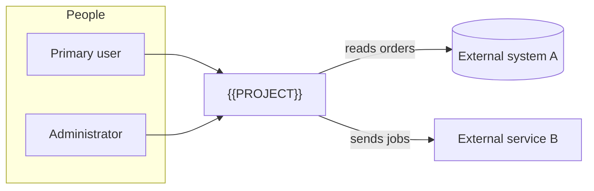

# RFC-001: {{PROJECT}} - <!-- FILL: one-line promise of the system, e.g. "one system for every team that ..." -->

| | |
|---|---|
| **Status** | Proposed <!-- FILL: the status becomes Accepted after the review that opens gate G-01; keep it equal to the status in the docs/README.md row. Remove this comment. --> |
| **Date** | {{DATE}} |
| **Author** | {{OWNER}} |
| **Reviewers** | <!-- FILL: the people or teams who must accept this RFC (business lead, integration owners, operations, security) --> |
| **Related** | [Requirements](../spec/requirements.md) - [ADRs](../adr/README.md) - [Architecture](../architecture.md) - [Roadmap](../roadmap.md) - [Decision log](../decision-log.md) |

This document proposes the design. It contains no code; contracts are described as field lists and diagrams.
Detailed behaviour lives in the requirements; decisions and their trade-offs live in the ADRs. This RFC links to
them instead of repeating them.

<!-- FILL: Add "- [Legacy sources and defect register](../legacy-sources.md)" to Related when a system is replaced. -->

## 1. Context and problem

<!-- FILL: Who has the problem today, how they work now, and why that is not good enough. If a system is replaced:
what it does (a short bullet list of its jobs) and why it cannot simply be patched, as a table of defect classes
with examples and their DEF-nn ids from legacy-sources.md. If it is new: the need, the current workaround and its
cost. Cite sources; do not copy them. Half a page to a page. -->

| Class | Examples | Register |
|---|---|---|
| <!-- FILL: e.g. Correctness, Security, Reliability, Maintainability --> | <!-- FILL: two or three examples --> | <!-- FILL: DEF-nn ids, or "-" for a new system --> |

## 2. Goals and non-goals

**Goals**

<!-- FILL: Numbered, five to eight goals, each testable in principle and each naming the ADR or requirement range
that delivers it. The first goal states what release 1 is. -->

1. <!-- FILL: goal (ADR-nnn, RF-nnn..nnn) -->

**Non-goals (explicitly out of release 1)**

<!-- FILL: Bullets for what a reader might expect and will not get in release 1, each with the release or reason.
The canonical "deliberately not built" list is docs/roadmap.md; keep these consistent with it. -->

- <!-- FILL: non-goal - where or why -->

**Scope decisions (agreed at kick-off)**

<!-- FILL: The same kick-off scope table as README.md (snapshot; canonical entries are DEC-nn rows in
../decision-log.md). When a later decision changes a row, append "(changed by DEC-nn)" to the Chosen cell. -->

| Question | Chosen | Instead of |
|---|---|---|
| <!-- FILL: question --> | <!-- FILL: chosen --> | <!-- FILL: rejected options --> |

## 3. Alternatives evaluated

<!-- FILL: Three or more whole-system alternatives, always including "do nothing / patch the current way". Mark the
chosen one. Sub-decisions with their own trade-offs belong in ADRs; list them in one sentence below the table. -->

| Alternative | Pros | Cons |
|---|---|---|
| **A. Do nothing / keep the current way** | <!-- FILL --> | <!-- FILL --> |
| **B.** <!-- FILL: alternative --> | <!-- FILL --> | <!-- FILL --> |
| **C.** <!-- FILL: alternative --> (chosen) | <!-- FILL --> | <!-- FILL --> |

Sub-decisions with their own trade-off tables live in the ADRs: <!-- FILL: ADR-nnn (topic), ... -->.

## 4. Proposed design

### 4.1 System context

<!-- FILL: A Mermaid flowchart with the people, this system, and every external system it talks to, with the
direction and the kind of each exchange on the edges. Replace the generic nodes below. -->

### 4.2 Containers

<!-- FILL: The deployable units (applications, services, workers, databases), what each owns and how they talk,
as a Mermaid diagram plus one line per container. Point to docs/architecture.md for the detail. -->

### 4.3 Domain model (concept level)

<!-- FILL: The main concepts and their relationships, as a short list or a Mermaid class diagram at concept level
(no columns). Name the aggregates and which one owns each state change. The glossary in the spec defines the terms. -->

### 4.4 Life cycle of the main entity

<!-- FILL: If a core entity has states, a Mermaid stateDiagram-v2 with every state and transition, and the ADR that
fixes it. The canonical state list lives in docs/architecture.md; this diagram must match it. Remove this section
when nothing has a life cycle. -->

### 4.5 Key flows

<!-- FILL: One subsection per end-to-end flow that matters to the reviewers (the main user journey, the riskiest
integration, the failure path). Each: a Mermaid sequence or flowchart diagram, three to eight lines of explanation,
and the RF ids it covers. Name what happens when each external system is slow, down or answers ambiguously. -->

### 4.6 Identity, authorization and audit

<!-- FILL: How users are identified, where roles and permissions come from, what is audited, with ADR ids. -->

### 4.7 Deployment topology

<!-- FILL: Where each container runs, per environment, and how an instance relates to sites, tenants or customers.
Canonical detail in docs/environments-and-delivery.md. -->

<!-- FILL: Add further 4.x subsections for platform capabilities (logging, integration framework, reports, modules)
as the project needs; when a need is added after the first version, add a subsection with "(added YYYY-MM-DD)" in
its heading instead of rewriting earlier ones. -->

## 5. Impact

**Risks**

| Risk | Mitigation |
|---|---|
| <!-- FILL: risk, with the Q-nn or DEF-nn it relates to --> | <!-- FILL: mitigation, with the phase or card that delivers it --> |

**Costs**: <!-- FILL: new deployables, licences, people's time, hardware or environments needed. -->

**Migrations**: <!-- FILL: what data or configuration moves from the current way of working, when, and by which
tool; "none" for a new system. -->

**Rollback**: <!-- FILL: how the organisation goes back if release 1 fails in its first weeks. -->

## 6. Implementation plan

Phases P0..Pn with exit criteria are maintained in [roadmap.md](../roadmap.md). Summary:

<!-- FILL: One row per phase, one line each, consistent with the roadmap. Exit criteria are not repeated here. -->

| Phase | Delivers |
|---|---|
| P0 | this documentation set, decisions, open questions |
| P1 | <!-- FILL --> |

## 7. Success criteria

<!-- FILL: Measurable targets for release 1: what, the target value, and how it is measured (query, test, timing,
sample). Include at least one correctness, one performance and one operability metric. -->

| Metric | Target | How measured |
|---|---|---|
| <!-- FILL --> | <!-- FILL --> | <!-- FILL --> |

## 8. Open questions

Maintained in one place: [requirements.md section 4](../spec/requirements.md#4-open-questions). Each question has an
owner, the phase that needs the answer and a default that applies until it is answered.
