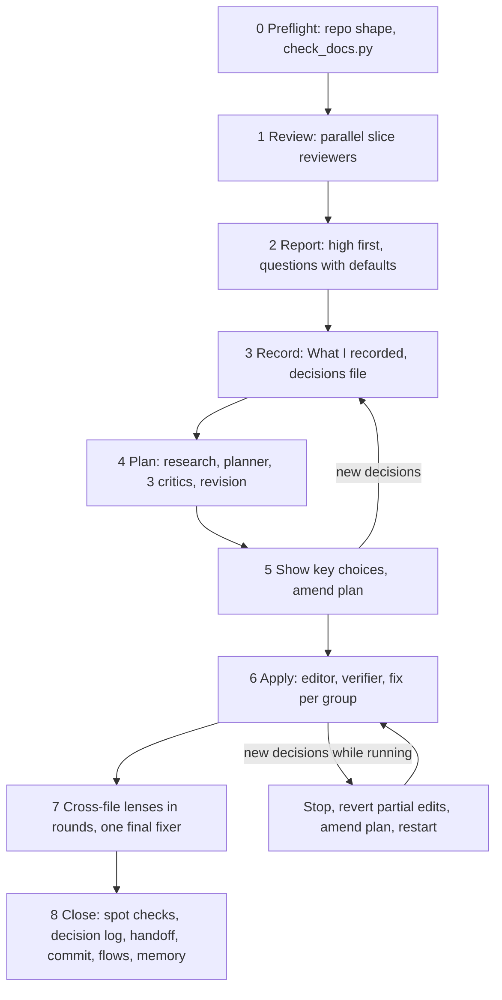

# Review and decision loop

Reference for REVIEW MODE: an existing documentation set (the layout in `docs-set.md`) is reviewed for
inconsistencies and holes, the owner answers questions, and the answers are applied across every document
without breaking cross-file identifiers. Use it when the user asks for a review, a consistency check, "find the
gaps", or brings new decisions for a project that already has the docs set. The worked example is
https://github.com/blacklight0101/Rosetta (its git history and `docs/decision-log.md` show several loops).

Talk to the user in their language; every file written into the repository is in English. No emojis.



Contents: Working files and ids | Step 0 - Preflight | Step 1 - Review with parallel read-only reviewers | Step 2 - Report to the user | Step 3 - Record the answers | Step 4 - Plan before editing | Step 5 - Show the user the key choices, then amend | Step 6 - Apply | Step 7 - Cross-file check lenses, then one final fixer | Step 8 - Close | Recovery rules | Small changes

## Working files and ids

All loop files live in the session scratchpad (`<scratch>` below), never in the repository:

| File | Written in step | Content |
|---|---|---|
| `<scratch>/check-docs-YYYY-MM-DD.txt` | 0 | output of `scripts/check_docs.py` |
| `<scratch>/review-findings-YYYY-MM-DD.md` | 1 | merged findings of all reviewers |
| `<scratch>/decisions-YYYY-MM-DD.md` | 3 | the owner's answers as DEC-nn, plus follow-ups |
| `<scratch>/decisions-YYYY-MM-DD-addendum-n.md` | 3 or 5 | later answers, one file per batch |
| `<scratch>/research-<topic>.md` | 4 | optional research and impact analyses |
| `<scratch>/change-plan.md` | 4, 5 | the canonical change plan |
| `<scratch>/change-plan.vN.bak.md` | 4, 5 | backup taken before each rewrite or amendment of the plan |

Ids used by the loop:

- Findings: slice letter plus number (`A1`, `B7`, `C20`). Critic issues: `F1` fidelity, `K1` consistency, `M1`
  completeness. Plan edits: `<FILEKEY>/nn` (for example `REQ/07`, `ARCH/12`, `TASKS/41`). Holes (missing
  decisions a reviewer found): `H-<slice letter><n>` (`H-B3`). All of these are plan-internal: they never
  appear in repository text.
- Questions to the user: `#1..#n` in the report. A question that stays open becomes a `Q-nn` row in
  `docs/spec/requirements.md` (next free number, never reused).
- Decisions: `DEC-nn`, continuing the numbering of `docs/decision-log.md`. Use the same id in the scratch
  decisions file and in the repository. Never invent a prefix that collides with one the repository already
  uses (`DEF-nn` are legacy defects).
- Repository ids (RF, RNF, Q, ADR, DEC, DEF, G, P<phase>-nn, RFC) follow the schemes in `docs-set.md` and are
  never renumbered. Withdrawn items keep their id with `Withdrawn YYYY-MM-DD - see ...`.

## Step 0 - Preflight

0. **Detect the shape.** Read `docs/README.md` and `handoff.md` first. Note the decision prefix the repository
   uses (`DEC` by default; an older or hand-built set may use another, for example `PD`), which optional parts
   are absent (legacy sources, design documents, process flows, the build plan) and any layout differences from
   `docs-set.md` (other file names, extra folders). Map the three reviewer slices of step 1 to the files that
   actually exist, and pass the same mapping to the workflow templates (`groups`, slice file lists) when they
   are used.
1. **Git state.** A clean tree (`git -C <repo> status --porcelain` empty) is required only before step 6, so
   partial edits can be reverted; the read-only review (steps 1-2) may run on a dirty tree, noted in the report.
   If the folder is not a git repository, review read-only and ask the user before running `git init` ahead of
   any apply step.
2. Note the HEAD commit (`git -C <repo> log -1 --format=%h`) when there is one. Findings cite line numbers "as of
   commit <sha>".
3. Run `python "<skill>/scripts/check_docs.py" "<repo>" --decision-prefix <prefix> --without <absent parts>`
   (omit the flags that do not apply) and save the output to `<scratch>/check-docs-YYYY-MM-DD.txt`. Leftover `{{` placeholders, `<!-- FILL` comments, broken relative
   links, duplicate or missing ids and table column mismatches are mechanical: they go into the report as one
   compressed block and the reviewers are told to skip them, so agent time goes to real contradictions.

## Step 1 - Review with parallel read-only reviewers

Three reviewers, one per slice, each reads its slice fully and may read any other file to confirm a
cross-file contradiction. They never edit anything and never change git state.

| Slice | Files | What to look for |
|---|---|---|
| A - Product | `docs/spec/requirements.md`, `docs/rfc/*.md`, `docs/roadmap.md`, `docs/process-flows.md`, `docs/legacy-sources.md`, `docs/decision-log.md`, `README.md`, `docs/README.md` | requirements that contradict each other or a rule; priorities vs roadmap phases; requirements in no phase; non-goals vs requirements; Q table status and answers; flows vs spec; defect register claims; traceability gaps; counts |
| B - Technical | `docs/adr/*.md`, `docs/architecture.md`, `docs/data-model.md`, `docs/conventions.md`, `docs/environments-and-delivery.md`, `CLAUDE.md` | ADR vs architecture; data constraints vs flows; permissions and grants vs actions; migration or version numbering; enum lists vs constraints; configuration and secrets; package baseline; ADR status counts |
| C - Delivery | `docs/orchestration/README.md`, `docs/orchestration/tasks.md`, `.claude/agents/*.md`, `handoff.md`, `docs/design-system.md`, `docs/design-system-brief.md` | card dependency cycles; a component or table used before the card that builds it; circular gates; counts per phase and band; verifier tools vs the checks it must run; stale handoff facts; design tokens vs pages; superseded briefs not marked |

Each reviewer returns two lists:

- **Inconsistencies**: severity high (a builder would build the wrong thing or two documents cannot both be
  true), medium (stale or ambiguous, a builder would have to guess), low (cosmetic, wording, counts in
  secondary places). Every item carries `file:line` evidence for BOTH sides of the contradiction and a proposed
  fix.
- **Holes**: something a builder needs that no document decides. Each carries the exact question for the owner,
  who owns the answer, when it is needed (phase), and a proposed default.

With the Workflow tool (see `workflows.md`) use `assets/workflows/review.js`; it also runs an adversarial
check on each slice's high findings and merges everything into `review-findings-YYYY-MM-DD.md`. Without it,
launch the three reviewers as parallel Agent calls in one message and merge their answers yourself.

Before reporting, **spot-verify every high finding yourself**: open both cited lines and confirm the
contradiction exists. Drop or downgrade what does not hold, and say so in the findings file.

Finding template (findings file):

```markdown
- A4 [high] Missing values stored as a sentinel vs the no-sentinel rule.
  Evidence: docs/spec/requirements.md:159 (RF-021 "stored as zeros"); CLAUDE.md:79 (no sentinel values);
  docs/data-model.md:106 (column is NULL when unknown).
  Proposal: store NULL and block the dependent action while the value is missing.
```

Hole template (findings file):

```markdown
- H-B3 [Architecture] Where do the passwords for the database logins come from?
  Owner: infrastructure lead. Needed by: P1. Why: P1-03 creates the logins.
  Default: created by the deploy account from the secret store; never in a migration file.
```

## Step 2 - Report to the user

Write the report in the user's language. Order:

1. **High inconsistencies** first, one or two lines each, with `file:line` on both sides and the proposed fix. The
   user must be able to say "agreed" or correct the fix.
2. **Medium and low** compressed, one line each, but still with `file:line` (for example "ADR index lists ADR-004
   as Accepted, `docs/adr/README.md:10` vs `docs/adr/ADR-004-...md:3`"). Compress the prose, never the
   evidence: the user and the later editors must be able to jump straight to the spot. Group same-kind items on
   one line ("counts stale: `handoff.md:12`, `docs/README.md:40`").
3. **Mechanical** issues from `check_docs.py` as one line with the count; they are fixed without asking.
4. **Numbered question table**, one row per hole and per inconsistency that needs a decision, WITH A DEFAULT
   FOR EVERY QUESTION, grouped by theme: Business rules, Architecture, Orchestration and design, Still owed
   (questions only an external party can answer: another team, a vendor, a date).

Answering is the owner's cost, so keep the table short: merge questions that one answer settles, put the ones that
block the next phase or gate first and mark them, and when more than about 20 remain, ask the blocking ones now
and offer to park the rest as `Q-nn` rows with their defaults (listed by number so the owner can still pick any).

Close with the one-line instruction that makes answering cheap: "Answer by number, or say 'defaults except #4,
#9' and give those two." Keep jargon out of the questions or explain it in the same row.

Question table template:

```markdown
| # | Theme | Question | Default | Owner | Needed by | Source |
|---|---|---|---|---|---|---|
| 1 | Business rules | May a cancelled order be reused? | Yes, unlimited, the same numbers are kept | Operations lead | P3 | H-A2 |
| 2 | Architecture | Roll back to the previous build on a newer schema? | Allow N-1 only | Product owner | P1 | A4 |
| 3 | Still owed | Review date for gate G-01? | None; stays open | Product owner | G-01 | H-C1 |
```

This is the same shape `assets/workflows/review.js` asks its merger for. Owner and Needed by go straight into
the `Q-nn` row when a question stays open; Source is the finding or hole id in the scratch findings file and
never goes into repository text.

## Step 3 - Record the answers

Answers often arrive dictated, mixed, or out of order. Never guess what the user meant.

1. Play back a **"What I recorded"** table, one line per question: number, the answer as understood, and what
   it will change. Ask the user to correct it.
2. Re-ask anything unclear in plain words, with an example ("a webhook is a call another system makes to ours
   when something changes; should we accept those calls?"). One short question per point.
3. Raise the follow-ups that the answers create ("if it works offline, what does the screen show before the
   server replies?"), each with a default.
4. Write `<scratch>/decisions-YYYY-MM-DD.md`. Only what the user said, or a default the user explicitly
   accepted ("use your default", "defaults except ..."). Anything the user did not decide stays a question
   with its default and is written to the Q table with Status `Default applies` - never as a decision.
5. Later batches of answers go to `decisions-YYYY-MM-DD-addendum-n.md`, never into an older file.

"What I recorded" template:

```markdown
| # | Your answer (as I understood it) | What changes |
|---|---|---|
| 1 | Yes, reuse allowed, unlimited | RF-111 stays; reuse keeps the numbers |
| 4 | Not sure - ask the operations lead | stays Q-17, default applies |
```

Decisions file template:

```markdown
# Decisions - <owner>, YYYY-MM-DD (answers to the review of YYYY-MM-DD)

Source: <owner> in chat on YYYY-MM-DD. Binding. Where the owner said "use your default", the default below is
the decision. Repo: <repo path>.

DEC-12 (answers #1) A cancelled order may be reused, unlimited times; the numbers are kept.
DEC-13 (answers #2, default accepted) The previous build may run on a schema one version ahead; nothing else.
DEC-14 (answers #7, partly) Opening hours are site data. Still open: who edits them -> Q-31, default: administrators.

Not decided (become or stay open questions, default applies):
- #4 -> Q-17, default: ...
```

## Step 4 - Plan before editing

Never edit the repository straight from the answers when more than a handful of files change. The plan is the
single source of truth that lets parallel editors work without talking to each other.

1. **Research (optional)**: read-only agents for facts the plan needs (legacy behaviour, a vendor interface)
   and one impact analysis per big decision (every document location that must change, with `file:line`).
   Each writes `<scratch>/research-<topic>.md`.
2. **One planner** writes `<scratch>/change-plan.md` with these sections, in this order:
   1. Principles: decisions win over existing text; ADRs are superseded or amended with dated notes, never
      rewritten or deleted; ids never renumbered; one date for all new notes; each document keeps its style;
      nothing invented.
   2. Registry: every identifier that crosses files, defined once: new and changed ids with titles, Q status
      changes, ADR numbers and exact file names, state names and transitions, tables and columns, migration
      numbers, permission codes and grants, settings with scope and default, design tokens, task card ids with
      difficulty and dependencies, gates, and every count (ADRs by status, cards by phase and band).
   3. Per-file edits: for each file, numbered edits `<FILEKEY>/nn`, each with the decision and finding ids it
      serves, the anchor (section, approximate line, current text gist) and the new text or its exact intent.
   4. Coverage table: every finding and every decision -> edit ids, or `no change - <reason>`.
   5. Items not decided: each becomes or stays a Q-nn with its default.
   6. Groups: editor groups with their files and edit counts. Every file belongs to exactly one group.
3. **Three critics** read the plan against the decisions and the repository: fidelity (every decision exactly,
   nothing invented, open items stay open), cross-file consistency (registry complete and unambiguous, no
   contradicting edits, no dependency cycles, counts add up), completeness (every finding and decision covered;
   grep the repository for each changed concept and list missed locations).
4. **The planner revises** in place (backup first) and appends section 7, Critique resolution: every critic
   issue with accepted or rejected and the reason.

With the Workflow tool use `assets/workflows/plan-changes.js`; otherwise run the research agents in parallel,
then the planner, then the three critics in parallel, then the planner again, as Agent calls.

Change plan skeleton:

```markdown
# <Project> change plan - YYYY-MM-DD

Inputs: decisions files ..., findings file ..., research files .... Repo: <path>, as of commit <sha>.
Notation: DEC-nn decisions; A1/B7 findings and <FILEKEY>/nn edit ids are plan-internal, never written to the repo.

## 1. Principles
## 2. Registry
### 2.1 Decisions and where they are applied
### 2.2 Requirement ids (new, changed, withdrawn)
### 2.3 Open questions (Q table rows and statuses)
### 2.4 ADRs (numbers, file names, statuses, supersedes/amends) and counts
### 2.n ... (states, tables, migrations, permissions, settings, tokens, cards and counts, gates)
## 3. Per-file edits
### 3.1 G1 - docs/spec/requirements.md
- REQ/01 [DEC-12, A4] section 3 RF-021 (about line 159) "stored as zeros" -> "stored as NULL; ..."
## 4. Coverage table
## 5. Items not decided
## 6. Groups and edit counts
## 7. Critique resolution
## 8. Amendment YYYY-MM-DD   (appended later, one section per amendment)
```

## Step 5 - Show the user the key choices, then amend

Before any editor runs, show the user (in their language) the design choices the plan makes that they did not
state literally (a new state, a new table, a merged rule, a default applied), the new ADRs and cards with the
new counts, and any surprising fact from research ("the old system does X, which contradicts answer #3").
Ask for corrections.

Corrections and new answers go into a new decisions addendum and then into the plan as an amendment: back up
the plan (`change-plan.vN.bak.md`), update the registry and the affected edits IN PLACE, and append
`## N. Amendment YYYY-MM-DD` listing every changed, added and removed edit id per group with a one-line reason.
Older sections are not rewritten; the amendment says what it supersedes. Use `plan-changes.js` in amend mode
or one planner agent.

## Step 6 - Apply

1. The tree must be clean (step 0, item 1). Editors run in parallel, one per group; groups have disjoint files.
2. Each editor reads sections 1, 2, 5, every amendment, and its own section 3 part; applies every edit; uses
   only registry identifiers; keeps the document's style; skips (and reports) an edit that is impossible or
   contradicts the registry; never writes plan-internal ids into documents.
3. Each group is followed by its own verifier (pipeline, no barrier): `git diff` of the group's files against
   the plan - every edit applied, nothing weaker, nothing invented, no collateral damage, identifiers exact.
   The verifier's issues go back to that group's editor for a fix.

With the Workflow tool use `assets/workflows/apply-changes.js`; without it, launch the editors in parallel
Agent calls (one message), then a verifier per group, then the fixes.

## Step 7 - Cross-file check lenses, then one final fixer

Run four read-only checkers over the whole repository, in rounds:

| Lens | Checks |
|---|---|
| Ids and counts | every referenced id exists (RF, RNF, Q, ADR, DEC, DEF, G, cards); counts identical everywhere they are stated; the ADR index lists every ADR file with the right status; card dependencies exist and have no cycles; registry names used exactly |
| Decision fidelity | every decision reads the same in every document that touches its topic; no leftover of the old design; undecided items are Q rows with a default |
| Stale-text sweep | grep for a list of terms built from the OLD design (removed states, old names, old counts, withdrawn rules); judge each hit in context |
| Structure and links | table column counts, relative links, section references across documents, no leaked plan-internal ids, no duplicated sections, ADRs follow the template, decision log well formed and linked |

Build the stale-term list while planning: every name the plan removes or renames, every old count, every
withdrawn rule's key words.

Issues found in a round are routed to the group that owns the file and fixed in parallel; re-check. Group
fixers skip issues that span groups, so finish with ONE final sequential fixer that may edit any file (use
`assets/workflows/final-pass.js`: lens rounds, one fixer per round). Stop when only low issues remain; report
those to the user instead of looping.

## Step 8 - Close

1. Own spot checks: run `check_docs.py` again; count ADRs by status and cards by phase and band and compare
   with every place that states them; grep the stale-term list; open a few edited passages.
2. `docs/decision-log.md`: one row per decision, columns `Id | Date | Decision | Answer to | Where applied`
   (Answer to = the Q-nn it answers or `Review YYYY-MM-DD`; never a plan-internal finding id). Rows are never
   edited later; a changed decision gets a new row that says which one it replaces.
3. `handoff.md`: last updated date, what changed, the questions still open, the resume point (link the Totals
   instead of restating counts).
4. Commit only when the user asks: on a branch (`docs/review-YYYY-MM-DD`), a message that names the decision
   range, then fast-forward the main branch (linear history). Never push unless asked.
5. Regenerate the process-flows PDF and the shared page if `docs/process-flows.md` changed (see
   `flows-and-sharing.md`).
6. Persist memory as SKILL.md section 9 says: `handoff.md` first; the workspace convention (for example a
   vault session log, the project's TODO note, a learning for anything reusable) if the workspace `CLAUDE.md`
   defines one; otherwise nothing outside `handoff.md`.

Decision log row template:

```markdown
| DEC-12 | YYYY-MM-DD | A cancelled order may be reused any number of times; the numbers are kept. | Q-09 | RF-111, ADR-006 (note), P3-04 |
```

Q table row template (requirements):

```markdown
| Q-17 | Who may edit the opening hours? | Operations lead | P1 | Administrators only | Default applies |
```

## Recovery rules

- **New decisions arrive while editors run**: stop the run (TaskStop), revert the partial edits with
  `git -C <repo> checkout -- .` plus removal of new untracked files the run created (`git clean` only on the
  paths it created, after listing them), confirm the tree is clean, amend the plan (step 5), restart the apply
  step. The tree must be clean before applying.
- **Never re-run a completed step that mutates a file in place** (a planner that backs up and rewrites the plan,
  an amendment): remove it from the script or switch it off before starting a fresh run. Resuming a run is safe
  only while that step's cached result is reused.
- **Resume cache**: changing ANY text of an agent prompt (including a constant interpolated into it)
  invalidates the cached result of that call and of everything after it. Fix typos before launching, not
  between resumes.
- **A verifier and an editor disagree**: the plan and the decisions win; when the plan itself is wrong, fix the
  plan (amendment) instead of letting editors improvise.
- **Counts drift**: counts live in one place (the ADR index Totals line; the `tasks.md` Totals table);
  everywhere else links. Check every restated number in each review.

## Small changes

For one to five decisions touching a few files, skip the plan and groups: one editor that applies the decisions
everywhere they matter (with an explicit grep list of stale terms), one adversarial verifier on the diff, one
fix. The decision log, handoff and spot checks of step 8 still apply.
